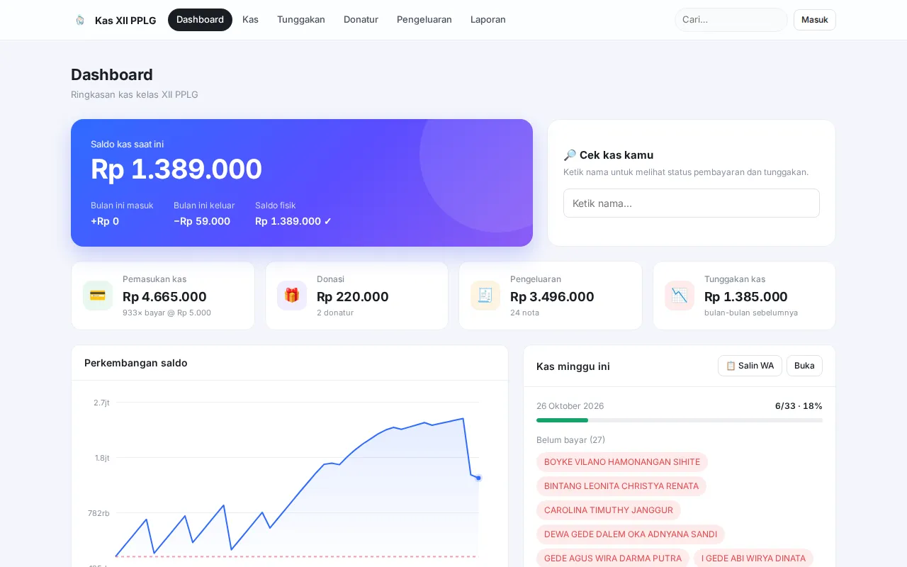
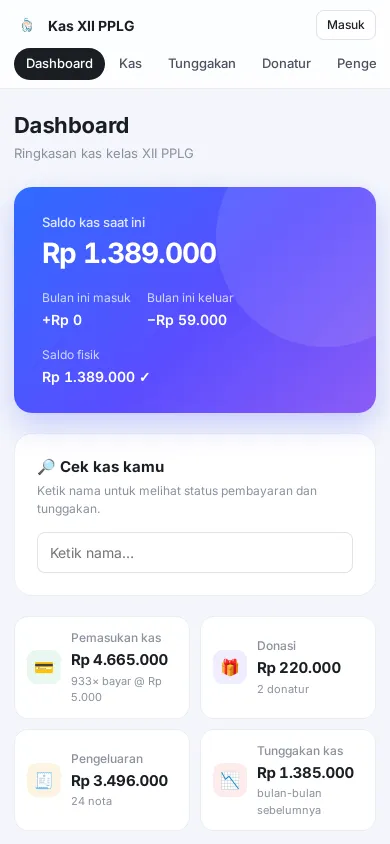

# Kas XII PPLG (versi statis)

Versi hanya-baca dari dashboard kas kelas XII PPLG, SMKN 2 Kuta Selatan, yang di-host di GitHub Pages. Siapa pun di kelas bisa membuka halaman ini untuk mengecek saldo, pengeluaran, dan status kas masing-masing tanpa perlu login.

**Buka:** [zynxx24.github.io/XII-PPLG---CASH-EXPORTED](https://zynxx24.github.io/XII-PPLG---CASH-EXPORTED/)

<p>
  
  
</p>

## Isi halaman

- Dashboard: saldo kas, pemasukan, donasi, pengeluaran, tunggakan, grafik perkembangan saldo, dan status kas minggu ini.
- Cek kas kamu: ketik nama untuk melihat status pembayaran dan tunggakan sendiri.
- Halaman Kas, Tunggakan, Donatur, Pengeluaran, dan Laporan.

## Dari mana datanya

Repo ini adalah hasil ekspor dari [Kas-XIIPPLG---cash-management](https://github.com/zynxx24/Kas-XIIPPLG---cash-management), aplikasi lengkapnya yang memakai server C. Data di folder `data/` dan `js/static_data.js` disalin dari sana setiap kali buku kas diperbarui, jadi angka di sini mengikuti pembaruan terakhir (lihat tanggal commit).

Perubahan data dilakukan di repo utama, bukan di sini.

## Menjalankan di komputer sendiri

Tidak perlu build. Buka `index.html` di browser, atau jalankan server statis apa saja:

```bash
python3 -m http.server 8000
# lalu buka http://localhost:8000
```
